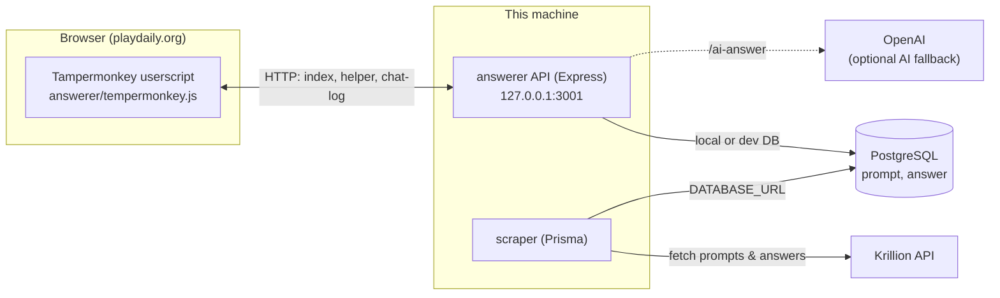

# Krillion Backend

Tools for collecting, storing, and serving answers for the [Krillion](https://playdaily.org/krillion) word game.

The repository has three parts that share a single PostgreSQL database:

| Folder | What it is |
|---|---|
| [`answerer/`](./answerer) | A local Express API and a Tampermonkey userscript. The script runs in the game page, records answers, shows the best known answers, can answer automatically, and runs an in-game chat bot. |
| [`scraper/`](./scraper) | A TypeScript/Prisma script that pulls prompts and their answers from the Krillion API. It also owns the database schema and migrations. |
| [`DB/`](./DB) | `krillion.sql`, a `pg_dump` backup of the database, used to seed a local database. |



## Prerequisites

- **Node.js** 20 or newer (developed on Node 24).
- **PostgreSQL** for the local database. Restoring `DB/krillion.sql` requires PostgreSQL client tools **18** or newer (`psql`), because the dump was made with `pg_dump` 18.
- **Tampermonkey** (or a compatible userscript manager) in your browser.
- **VPN access** if you use the shared development database. It is on a private network and is unreachable without the VPN.
- Optional: an **OpenAI API key** for the AI fallback answer.

## Setup

### 1. Install dependencies

Each component has its own `package.json`:

```powershell
cd answerer
npm install
cd ..\scraper
npm install
```

### 2. Create `.env` in the repository root

Both components read the **root** `.env` file. It is git-ignored; never commit it.

```dotenv
PORT=3001

# Local PostgreSQL (answerer "Local" option)
DB_HOST=127.0.0.1
DB_PORT=5432
DB_NAME=krillion
DB_USER=postgres
DB_PASSWORD=<your-local-password>

# Shared development PostgreSQL (answerer "Remote" option, scraper, Prisma)
DATABASE_URL=postgresql://<user>:<password>@<host>:5432/<database>

# Optional AI fallback
OPENAI_API_KEY=<your-openai-key>
OPENAI_MODEL=gpt-5-mini
AI_FALLBACK_ENABLED=false
```

| Variable | Used by | Purpose |
|---|---|---|
| `PORT` | answerer | API port. Keep it at `3001`: the userscript calls `http://127.0.0.1:3001`. |
| `DB_HOST`, `DB_PORT`, `DB_NAME`, `DB_USER`, `DB_PASSWORD` | answerer | Local database connection. |
| `DATABASE_URL` | answerer, scraper, Prisma CLI | Development database connection. |
| `OPENAI_API_KEY`, `OPENAI_MODEL` | answerer | OpenAI credentials and model for `/ai-answer`. |
| `AI_FALLBACK_ENABLED` | answerer | Set to `true` to enable the AI fallback. |

### 3. Prepare the database

**Option A: restore the backup into a local database (includes data).**

```powershell
createdb -U postgres krillion
psql -U postgres -d krillion -f DB\krillion.sql
```

**Option B: create an empty schema with Prisma migrations.** Prisma uses `DATABASE_URL`, so point it at the database you want to migrate:

```powershell
cd scraper
npx prisma migrate deploy
```

Schema changes belong in [`scraper/prisma/schema.prisma`](./scraper/prisma/schema.prisma). Create a migration with `npx prisma migrate dev --name <name>`, then apply it to every database you use (local and dev) so they stay identical.

### 4. Install the userscript

1. Open the Tampermonkey dashboard and create a new script.
2. Replace its contents with [`answerer/tempermonkey.js`](./answerer/tempermonkey.js) and save.
3. It runs on `https://playdaily.org/krillion*`. Re-paste the file whenever it changes.

## Usage

### Run the answerer API

Run it **from the repository root**, so the root `.env` is loaded:

```powershell
node answerer\start.js
```

Choose the database when prompted:

```text
[1] Local PostgreSQL
[2] Remote Development PostgreSQL
```

The server verifies the connection, then listens on `http://127.0.0.1:3001` (local machine only). Check it with:

```powershell
curl http://127.0.0.1:3001/health
```

> Running `npm start` inside `answerer/` does **not** load the root `.env`. Use the command above, or keep a copy of `.env` in `answerer/`.

### Play with the userscript

With the API running, open Krillion. The **Krillion Answer Helper** panel appears on the page. All features work in **Classic** matches only.

- **Indexing:** answers and scores revealed at the end of each round are saved to the database (`POST /index`) and to the browser's IndexedDB.
- **Answer list:** pick a question to see its best known answers. Unknown questions fall back to the best answers from questions in the same category.
- **AUTO-MODE:** submits the best untried known answer automatically. If no answer is known, the AI fallback (when enabled) is used only after 3 unanswered rounds in a row, i.e. when you appear to be AFK.
- **CHAT-BOT:** answers commands from players in the game chat. Chat messages are logged to `answerer/logs/chat-YYYY-MM-DD.log` (git-ignored).

Chat commands use the prefix `/portik` or `/p`:

| Command | Effect |
|---|---|
| `/p ans` (or `/p answer`) | Posts a top answer for the current question. |
| `/p say <text>` | Repeats the text. |
| `/p lang <language>` | Changes the bot language: `english`, `klingon`, `mandarin`, `indian`, `ido`, `krillish`. |
| `/p mute` / `/p unmute` | Stops or resumes answers, with cooldowns. |
| `/p stats` | Shows bot statistics. |
| `/p about` / `/p help` | Describes the bot or lists commands. |

### Run the scraper

The scraper writes to the database in `DATABASE_URL` (the development database), so connect to the VPN first.

```powershell
cd scraper
npm run dev              # run directly from TypeScript
# or
npm run build
npm start                # run the compiled build/index.js
```

It requests batches of prompts from the Krillion API (30 rounds of 3 parallel requests), saves new prompts and their categories, then stores each prompt's answers. When the API rate-limits a request, it waits the requested time and retries.

## API reference

All endpoints are served by [`answerer/server.js`](./answerer/server.js). CORS allows only `https://playdaily.org`.

| Method | Path | Description |
|---|---|---|
| `GET` | `/health` | Database connectivity check. |
| `GET` | `/stats` | Prompt and answer totals. |
| `POST` | `/index` | Saves a prompt and its answers. Body: `{ promptId, question, answers: [{ answer, score }] }`. Existing question text is kept, and scores are only ever raised. |
| `GET` | `/helper/:promptId` | Up to 51 best answers. `?cat=<category>` enables category fallback; `?worst=1` lists the lowest-scoring first. |
| `GET` | `/prompt-lookup?q=<question>` | Finds a prompt by its text (case- and whitespace-insensitive). |
| `POST` | `/ai-answer` | Asks OpenAI for one answer. Body: `{ question }`. Disabled unless `AI_FALLBACK_ENABLED=true`; limited to 4 requests per minute. |
| `POST` | `/chat-log` | Appends chat lines to the daily log file. |

## Data model

Defined in [`scraper/prisma/schema.prisma`](./scraper/prisma/schema.prisma):

| Table | Columns | Notes |
|---|---|---|
| `prompt` | `id` (PK), `text` (unique), `cat` (nullable category) | One row per question. Question text must be unique. |
| `answer` | `promptId` (FK → `prompt.id`), `text`, `value` | Primary key is `(promptId, text)`. Deleting a prompt deletes its answers. |

`answer.value` stores the score tier. The game's points map to tiers as follows:

| Points | 4 | 8 | 16 | 32 | 64 | 100 |
|---|---|---|---|---|---|---|
| `value` | 0 | 1 | 2 | 3 | 4 | 5 |
| Tier | Plankton | Too Clever | Schooler | Rare | Deep Cut | One in a Krillion |

## Troubleshooting

| Problem | Fix |
|---|---|
| `Database not selected. Start using: npm start` | Start through `start.js` (`node answerer\start.js`), not `server.js`. |
| Remote connection times out (`ETIMEDOUT`/`ECONNREFUSED` to a `10.x` address) | Connect to the VPN. |
| Local connection fails with missing credentials | Run from the repository root, so the root `.env` is loaded. |
| The panel shows no answers | Make sure the API is running on port `3001`, and check `/health`. |
| `psql` errors on `\restrict` while restoring | Use PostgreSQL 18+ client tools. |
